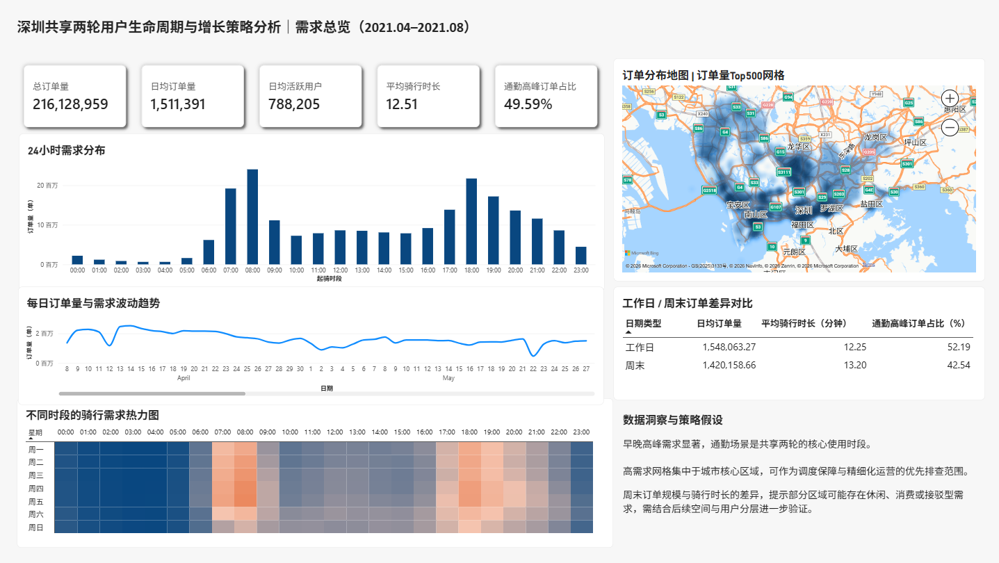
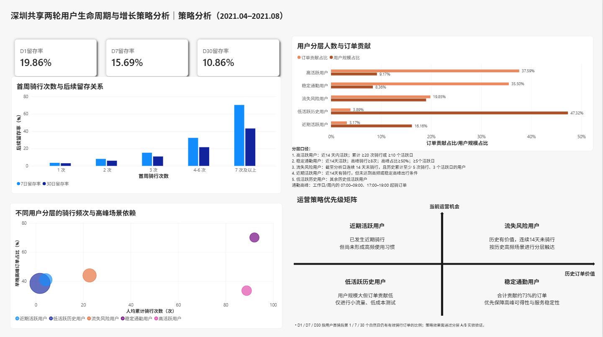

# 深圳共享两轮用户生命周期与增长策略分析

基于深圳共享两轮匿名订单数据，使用 Python、DuckDB、SQL 与 Power BI 完成从数据质量检查、订单清洗、需求分析到空间热点识别的可复现分析流程。本项目将描述性数据发现转化为待验证的增长与运营策略假设。

> 原始订单数据、处理后的明细、DuckDB 数据库与 Power BI 源文件均不上传至 GitHub；项目仅公开可复现代码、指标口径、看板截图和分析方法。

## 看板预览





Power BI 交互式看板链接将在确认数据使用与公开发布条件后补充。

## 项目回答的业务问题

1. 一天中哪些时段的骑行需求最高，工作日与周末有何差异？
2. 需求在城市空间上集中于哪些起点网格？
3. 如何基于首现、活跃和沉默行为构建用户生命周期与留存分析框架？
4. 对不同人群和场景，可以优先验证哪些增长、召回与服务保障策略？

## 当前阶段成果：需求总览与策略分析

### 数据范围与清洗

- 稳定观察期：**2021-04-08 至 2021-08-28**，共 143 天。
- 最终有效订单：**216,128,959** 笔；去重匿名用户：**9,966,667** 人。
- 清洗规则：保留骑行时长 1–1,440 分钟的订单；剔除时长不足 1 分钟及超过 24 小时的极端记录。
- 空间分析：将订单起点聚合至约 500 米网格，不展示单个用户的轨迹或精确起点。

### 需求发现

- 日均订单量约 **151 万**，日均活跃用户约 **78.8 万**。
- 早晚高峰显著，通勤高峰订单占比约 **49.59%**。
- 工作日的日均订单量和通勤高峰占比高于周末；周末平均骑行时长更长。
- 高需求起点网格集中于城市核心区域，可作为调度保障、重点巡检和场景化运营的优先排查范围。

上述结论用于发现机会与提出假设，不代表策略已带来因果增量。

## 策略假设

| 目标人群 / 场景 | 观察信号 | 待验证策略 | 主指标 | 护栏指标 |
|---|---|---|---|---|
| 首周低激活用户 | 首周仅骑行 1 次 | 降低第二次骑行门槛，促进完成重复骑行 | 7 日复骑率 | 补贴成本、投诉率、异常订单率 |
| 流失风险用户 | 历史至少 5 次骑行、3 个活跃日，但连续 14 天未骑行 | 在历史高频场景进行分层触达 | 7 日回流率 | 打扰率、退订率、成本 |
| 稳定通勤用户 | 近期活跃，早晚高峰骑行占比较高 | 优化高峰服务确定性 | 30 日留存率 | 负反馈率、服务成本 |

完整策略说明见 [docs/strategy_playbook.md](docs/strategy_playbook.md)。由于公开订单数据不含曝光、优惠券、价格、支付、车辆库存与投诉数据，所有策略均需补充业务链路数据后，以分层随机 A/B 实验验证。

## 项目结构

```text
Shenzhen_bike_user_Lifecycle_Analytics/
├── config.example.toml          # 本地数据路径配置模板
├── requirements.txt
├── sql/
│   ├── 01_build_fact_trip_base.sql
│   ├── 02_build_fact_trip_clean.sql
│   ├── 03_build_demand_marts.sql
│   ├── 04_build_origin_grid_mart.sql
│   └── 05_build_lifecycle_strategy_marts.sql
├── src/
│   ├── 00_check_data.py
│   ├── 01_build_staging_and_profile.py
│   ├── 02_run_fact_trip_base.py
│   ├── 03_profile_trip_duration.py
│   ├── 04_run_fact_trip_clean.py
│   ├── 05_run_demand_marts.py
│   ├── 06_run_origin_grid_mart.py
│   └── 07_run_lifecycle_strategy_marts.py
├── docs/
│   ├── data_dictionary.md
│   ├── metric_definitions.md
│   ├── dashboard_spec.md
│   ├── strategy_playbook.md
│   └── lifecycle_strategy_findings.md
└── dashboard/
    ├── README.md
    └── screenshots/
        ├── 01_demand_overview.png
        └── 02_strategy_analysis.png
```

## 复现步骤

1. 复制 `config.example.toml` 为本地 `config.toml`，填写原始数据目录。
2. 安装依赖：`python -m pip install -r requirements.txt`。
3. 按以下顺序运行脚本：

```text
python src/00_check_data.py
python src/01_build_staging_and_profile.py
python src/02_run_fact_trip_base.py
python src/03_profile_trip_duration.py
python src/04_run_fact_trip_clean.py
python src/05_run_demand_marts.py
python src/06_run_origin_grid_mart.py
python src/07_run_lifecycle_strategy_marts.py
```

4. 将 `data/marts/` 下的聚合 CSV 导入 Power BI，按照 [docs/dashboard_spec.md](docs/dashboard_spec.md) 搭建看板。

## 指标与边界

- 指标口径见 [docs/metric_definitions.md](docs/metric_definitions.md)。
- `观察期首现用户` 不等同于平台注册新用户。
- 直线距离不等同于实际路网骑行距离。
- 本项目不对平台供给不足、服务故障或策略效果作因果推断。
